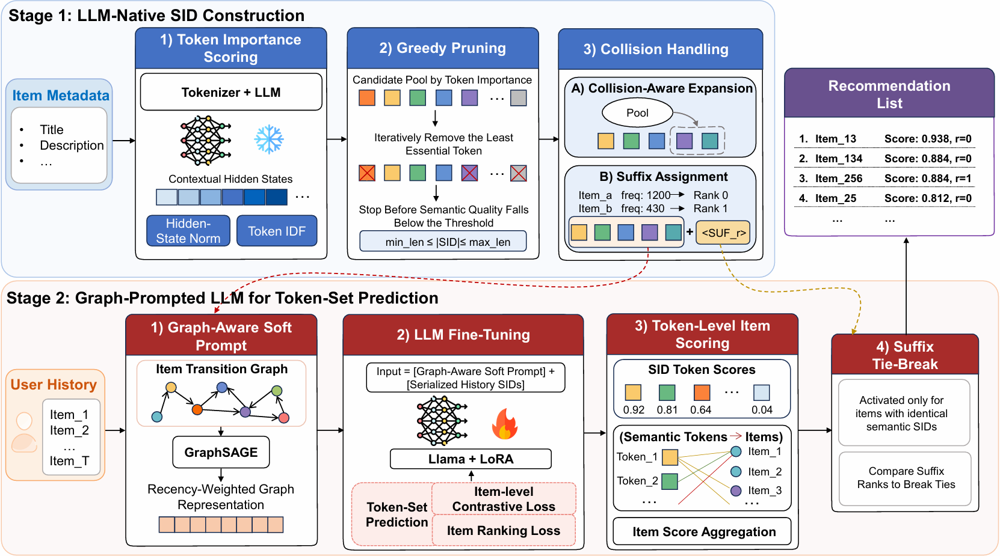

# VaLiDRec: Variable-length LLM-aligned Semantic IDs for Generative Recommendation

## Abstract

Generative recommendation commonly represents items with semantic identifiers (SIDs). Existing methods typically construct fixed-length SIDs through clustering and quantization, producing artificial latent codes that compress item semantics, are misaligned with pretrained large language model (LLM) vocabularies, and require costly autoregressive decoding during inference. These limitations hinder semantic expressiveness, cold-start recommendation, and retrieval efficiency.

In light of this, we propose **VaLiDRec**, a generative recommendation framework based on variable-length, LLM-aligned semantic identifiers. VaLiDRec constructs SIDs directly from informative native LLM vocabulary tokens via token importance estimation, semantic-quality-aware pruning, and collision-aware refinement, allowing identifier lengths to adapt to item semantic complexity. To model user preferences, VaLiDRec incorporates graph-aware soft prompts and reformulates recommendation as token-set prediction with inverted-index retrieval, eliminating autoregressive SID generation and beam search.

Experiments on four real-world datasets show that VaLiDRec consistently outperforms strong sequential and generative recommendation baselines across all evaluation metrics. It further achieves superior zero-shot item cold-start performance and **87.07× faster inference** than LC-Rec. These results demonstrate that LLM-native variable-length semantic identifiers provide a more expressive and efficient paradigm for generative recommendation.

## Framework

<p align="center">
  
</p>

<p align="center">
  <em>
    Overview of VaLiDRec. Stage 1 constructs variable-length semantic identifiers directly from native LLM vocabulary tokens through token importance estimation, semantic-quality-aware pruning, and collision-aware refinement. Stage 2 incorporates graph-aware soft prompts and formulates recommendation as token-set prediction followed by efficient inverted-index retrieval.
  </em>
</p>

### Stage 1: LLM-native SID construction

Given an item's title and description, Stage 1:

1. tokenizes the metadata with the Stage 1 LLM tokenizer;
2. scores token occurrences using contextual hidden-state norm and token IDF;
3. builds a candidate pool from importance, IDF, hidden-state norm, and prefix
   candidates;
4. greedily removes the least essential candidates while enforcing semantic
   quality and SID-length constraints;
5. expands residual collision groups with unused candidate tokens;
6. assigns a non-semantic suffix rank to any remaining collision group.

The saved SID schema keeps semantic content and disambiguation separate:

```json
{
  "42": {
    "semantic_tokens": [100, 200, 300],
    "semantic_weights": [0.4, 0.3, 0.3],
    "suffix_rank": 1
  }
}
```

`suffix_rank` is not an LLM token. It is excluded from graph construction,
history serialization, token-set prediction, semantic scoring, and all training
losses.

### Stage 2: graph-prompted token-set recommendation

Given a user's item history, Stage 2:

1. initializes item representations by averaging semantic SID token
   embeddings;
2. constructs a mini-batch item-transition graph;
3. applies a two-layer GraphSAGE encoder;
4. pools graph-enhanced history representations with recency weights;
5. prepends eight continuous graph-aware prompt embeddings to the serialized
   history SIDs;
6. fine-tunes Llama with LoRA using token-set, item-ranking, and item-level
   contrastive objectives;
7. scores all semantic SID tokens in one LLM forward pass;
8. aggregates token probabilities over item SIDs with an inverted index;
9. uses the smaller suffix rank only when items share an identical semantic
   SID.

The training objective is:

```text
L = L_token + alpha * L_rank + beta * L_item
```

The repository currently uses `beta = 0.1` in the training loop and exposes
`alpha` as `--item_rank_alpha`.

## Repository layout

```text
.
|-- Figures/
|   `-- framework.png
|-- data/
|   |-- raw/
|   |   |-- Metadata/
|   |   |-- Ratings/
|   |   `-- Review/
|   |-- processed/
|   |   |-- Luxury/
|   |   `-- Luxury_item_cold_raw_review/
|   `-- sids/
|-- scripts/
|   |-- run_stage1.sh
|   |-- run_stage2.sh
|   |-- run_pipeline.sh
|   |-- run_stage1.ps1
|   |-- run_stage2.ps1
|   `-- run_pipeline.ps1
|-- stage1/
|   |-- builder.py
|   |-- collision.py
|   |-- config.py
|   |-- data.py
|   |-- pipeline.py
|   |-- pruning.py
|   `-- run.py
|-- stage2/
|   |-- config.py
|   |-- data.py
|   |-- graph.py
|   |-- metrics.py
|   |-- objectives.py
|   |-- retrieval.py
|   |-- sid.py
|   |-- utils.py
|   `-- run.py
|-- utils.py
```


## Environment

### Recommended platform

- Linux for GPU training and the provided Bash scripts
- Python 3.10 or newer
- A CUDA-capable NVIDIA GPU
- CUDA-compatible PyTorch

The paper experiments were conducted on NVIDIA H100 GPUs. Stage 1 loads
Llama-3.1-8B and is the more memory-intensive stage. Actual memory requirements
depend on model precision, metadata length, batch behavior, and the selected
backbone.

### Python dependencies

Create an isolated environment:

```bash
python -m venv .venv
source .venv/bin/activate
python -m pip install --upgrade pip
```

Install a PyTorch build that matches the CUDA version on the target machine,
then install the remaining packages:

```bash
pip install torch
pip install transformers peft accelerate numpy tqdm
```

The main runtime dependencies are:

- `torch`
- `transformers`
- `peft`
- `accelerate`
- `numpy`
- `tqdm`

Stage 2 imports `peft` only when training starts, so configuration help and
lightweight module inspection do not require it.

### Llama access

The default backbones are:

```text
Stage 1: meta-llama/Meta-Llama-3.1-8B
Stage 2: meta-llama/Llama-3.2-1B
```

These models may require accepting the model license and authenticating with
Hugging Face:

```bash
huggingface-cli login
```

Both stages must use tokenizers with compatible native vocabulary mappings,
because Stage 1 stores native vocabulary token IDs that Stage 2 consumes.

An optional Hugging Face cache can be supplied with:

```bash
export HF_CACHE_DIR=/path/to/huggingface/cache
```

## Datasets

### Paper benchmark

The manuscript evaluates four domains from the
[Amazon Review Data (2018)](https://cseweb.ucsd.edu/~jmcauley/datasets/amazon_v2/)
under standard 5-core evaluation and one zero-shot item cold-start split.

| Dataset | Users | Items | Interactions | Sparsity |
|---|---:|---:|---:|---:|
| Luxury | 1,841 | 842 | 18,667 | 98.80% |
| Scientific | 2,843 | 1,549 | 19,099 | 99.57% |
| Instruments | 17,112 | 6,250 | 136,226 | 99.87% |
| Arts | 22,171 | 9,416 | 174,079 | 99.92% |
| Luxury zero-shot item cold-start | 19,748 | 8,308 | 47,913 | 99.97% |

The current repository defaults to the processed **Luxury** standard split.
The other paper domains are not configured as defaults and must follow the
same directory and filename conventions described below.

### Included Luxury split

The local processed Luxury files contain 1,841 users, 842 metadata items, and
842 unique items across all splits.

| Split | Next-item records | Users | Covered items |
|---|---:|---:|---:|
| Train | 13,144 | 1,841 | 837 |
| Validation | 1,841 | 1,841 | 841 |
| Test | 1,841 | 1,841 | 842 |

The split rows are next-item prediction records, whereas the paper's
interaction count refers to filtered interaction events. These quantities are
therefore not expected to be identical.

### Processed data layout

For a dataset named `<dataset>`, place files under:

```text
data/processed/<dataset>/
|-- <dataset>.item.json
|-- <dataset>.train.inter
|-- <dataset>.valid.inter
`-- <dataset>.test.inter
```

The `.inter` files use tab-separated columns:

```text
user_id:token    item_id_list:token_seq    item_id:token
```

Example:

```text
0    0 1 2 3 4 5    6
```

This represents user `0`, historical items `[0, 1, 2, 3, 4, 5]`, and target
item `6`.

`<dataset>.item.json` maps remapped integer item IDs to metadata:

```json
{
  "0": {
    "title": "...",
    "description": "...",
    "brand": "...",
    "categories": ["..."]
  }
}
```

The current Stage 1 pipeline constructs metadata text from `title` and
`description`.

## Quick start

All commands below assume the repository root as the working directory.

### Linux or HPC

Run Stage 1:

```bash
bash scripts/run_stage1.sh
```

Run Stage 2 after the SID artifact has been generated:

```bash
bash scripts/run_stage2.sh
```

Run both stages sequentially:

```bash
bash scripts/run_pipeline.sh
```

### Windows PowerShell

```powershell
.\scripts\run_stage1.ps1
.\scripts\run_stage2.ps1
.\scripts\run_pipeline.ps1
```

The scripts default to:

```text
Dataset: Luxury
GPU: 0
Stage 1 model: meta-llama/Meta-Llama-3.1-8B
Stage 2 model: meta-llama/Llama-3.2-1B
Top-M approximation: disabled
```

Environment variables can override the defaults:

```bash
DATASET=Luxury \
GPU_ID=0 \
STAGE1_MODEL=meta-llama/Meta-Llama-3.1-8B \
STAGE2_MODEL=meta-llama/Llama-3.2-1B \
HF_CACHE_DIR=/path/to/huggingface/cache \
bash scripts/run_pipeline.sh
```

Additional arguments can be appended to an individual stage script:

```bash
bash scripts/run_stage2.sh --batch_size 8 --num_epochs 100
```

See [`scripts/README.md`](scripts/README.md) for script-specific examples.

## Manual execution

### Stage 1

```bash
python -m stage1.run \
  --dataset Luxury \
  --root data/processed \
  --gpu_id 0 \
  --model_name_or_path meta-llama/Meta-Llama-3.1-8B
```

Stage 1 writes:

```text
data/sids/<dataset>/<dataset>.sid-set-token-weight-stage1.json
data/sids/<dataset>/<dataset>.sid-set-token-quality-stage1.json
```

### Stage 2

```bash
python -m stage2.run \
  --dataset_path data/processed/Luxury \
  --train_file Luxury.train.inter \
  --valid_file Luxury.valid.inter \
  --test_file Luxury.test.inter \
  --sid_json data/sids/Luxury/Luxury.sid-set-token-weight-stage1.json \
  --device cuda:0 \
  --topm_tokens 0
```

Stage 2 writes logs and checkpoints to:

```text
logs/LLMSetSID/<dataset>/
checkpoints/LLMSetSID/<dataset>/
```

## Parameters

### Stage 1 parameters

| Argument | Default | Description |
|---|---|---|
| `--dataset` | `Luxury` | Dataset directory and filename prefix |
| `--root` | `data/processed` | Root containing processed dataset directories |
| `--gpu_id` | `1` | CUDA device index; scripts override this to `0` |
| `--model_name_or_path` | `meta-llama/Meta-Llama-3.1-8B` | LLM used to construct SIDs |
| `--model_cache_dir` | `None` | Optional Hugging Face cache |
| `--max_sent_len` | `2048` | Maximum metadata token length |
| `--semantic_quality_threshold` | `0.95` | Minimum semantic quality for optional pruning |
| `--pruning_pool_size` | `64` | Maximum candidate-pool size |
| `--distinctiveness_lambda` | `0.05` | Penalty for deleting discriminative tokens |
| `--candidate_prefix_tokens` | `8` | Prefix positions added to the candidate pool |
| `--max_collision_expand_rounds` | `8` | Maximum collision-expansion rounds |
| `--functional_layer_idx` | `-1` | Hidden-state layer used for SID construction |
| `--min_tokens` | `2` | Target minimum SID length when valid candidates exist |
| `--max_tokens` | `16` | Maximum semantic SID length |

These values match the main Stage 1 settings reported in the manuscript.

### Stage 2 parameters

| Argument | Repository default | Description |
|---|---|---|
| `--dataset_path` | `data/processed/Luxury` | Processed split directory |
| `--sid_json` | `data/sids/Luxury/Luxury.sid-set-token-weight-stage1.json` | Stage 1 SID artifact |
| `--model_name_or_path` | `meta-llama/Llama-3.2-1B` | Recommendation backbone |
| `--model_cache_dir` | `None` | Optional Hugging Face cache |
| `--device` | `cuda:3` | Training device; scripts override this to `cuda:0` |
| `--seed` | `2025` | Random seed |
| `--use_bf16` | `True` | Prefer BF16 when supported |
| `--batch_size` | `32` | Training batch size |
| `--num_epochs` | `200` | Maximum training epochs |
| `--lr` | `1e-4` | AdamW learning rate |
| `--grad_clip` | `1.0` | Gradient-norm clipping threshold |
| `--early_stop` | `10` | Epochs without validation improvement before stopping |
| `--max_history_items` | `20` | Maximum recent items in user history |
| `--pos_weight` | `5.0` | Positive-class weight for token-set BCE |
| `--item_rank_alpha` | `0.8` | Weight of item-ranking loss |
| `--item_rank_neg_items` | `64` | Sampled negative items per user |
| `--lora_r` | `16` | LoRA rank |
| `--lora_alpha` | `32` | LoRA scaling factor |
| `--lora_dropout` | `0.05` | LoRA dropout |
| `--lora_targets` | `q_proj v_proj` | LoRA target modules |
| `--infer_batch_size` | `32` | Evaluation batch size |
| `--topk_list` | `1 3 5 10 20` | Reported metric cutoffs |
| `--topk_items` | `20` | Number of returned items |
| `--topm_tokens` | `0` | `<= 0` scores every semantic SID token; positive values enable Top-M approximation |
| `--test_on` | `improve` | Run test evaluation when validation improves, or every epoch |
| `--save_on` | `test` | Metric group used to trigger checkpoint saving |

The graph prompt uses two GraphSAGE layers and eight prompt embeddings.
The item-level contrastive temperature is `0.2`, and `beta` is fixed to `0.1`.

The default Stage 2 batch size of `32` matches the setting reported in the
manuscript.

For strict validation-based model selection, use:

```bash
python -m stage2.run --save_on val
```

## Retrieval and evaluation

By default, `--topm_tokens 0` disables Top-M approximation. Stage 2 therefore:

1. scores every semantic token appearing in the item SID collection;
2. traverses the complete token-to-item inverted index;
3. averages accumulated token probabilities by each item's unique SID length;
4. ranks items by semantic score;
5. applies suffix tie-break only within identical semantic-SID groups.

Set a positive value such as `--topm_tokens 6000` to enable approximate
Top-M token retrieval.

The implementation reports Recall@K and NDCG@K. The default cutoffs include
`1, 3, 5, 10, 20`; the manuscript reports standard results at `5, 10, 20`
and cold-start results at `50, 100`.

## Reproducibility notes

- Stage 1 SID construction is offline. Reuse the generated SID JSON for all
  Stage 2 runs that share the same metadata, tokenizer mapping, and Stage 1
  settings.
- Stage 2 enables deterministic PyTorch algorithms and seeds Python, NumPy,
  and PyTorch with `--seed`.
- The manuscript averages results over five runs with different seeds.
- SID token IDs are meaningful only under a compatible tokenizer vocabulary.
- The suffix rank is a deterministic non-semantic key and must never enter
  semantic token scoring.
- Top-M approximation is disabled by default in this repository.

## Troubleshooting

### `ModuleNotFoundError: No module named 'peft'`

Install the Stage 2 training dependencies:

```bash
pip install peft accelerate
```

### Cannot access a Llama checkpoint

Accept the corresponding model license on Hugging Face and authenticate:

```bash
huggingface-cli login
```

### Stage 2 reports a missing SID artifact

Run Stage 1 first:

```bash
bash scripts/run_stage1.sh
```

Expected output:

```text
data/sids/Luxury/Luxury.sid-set-token-weight-stage1.json
```
